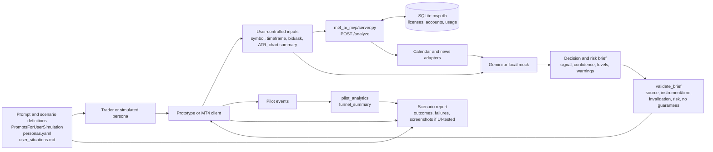

# EUR/JPY brief pilot architecture

This sketch applies the Session 10 harness: a fixed product directive feeds the spec, the
implementation is checked by tests, and synthetic users exercise the workflow without being
treated as evidence from real participants.

## Layers and ownership

| Layer | Current implementation | Responsibility |
|---|---|---|
| Product contract | [product_directive.md](analysis/product_directive.md) | Keeps instrument/time, evidence, uncertainty, invalidation, risk, and non-guarantee rules fixed during an experiment wave. |
| User harness | [personas.yaml](../personas.yaml), [user_situations.md](analysis/user_situations.md), `PromptsForUserSimulation/` | Defines who follows a scenario, what they attempt, and what must be observed. |
| Client | MT4 thin EA in `mt4_ai_mvp/static/` or a future browser UI | Collects user-controlled market inputs and displays the response; it does not execute trades. |
| Service | [server.py](../mt4_ai_mvp/server.py) | Authenticates a license, binds accounts, fetches calendar/news context, calls Gemini or the local mock, and returns JSON. |
| Persistence | `mt4_ai_mvp/mvp.db` | Stores plans, users, licenses, bound accounts, and usage/quota records. |
| Quality gate | [brief.py](../src/pilot_analytics/brief.py) | Detects missing context, unsupported claims, missing invalidation/risk warnings, and guarantee language. |
| Measurement | [funnel.py](../src/pilot_analytics/funnel.py) | Counts sessions rather than duplicate events and reports activation with visible denominators. |
| Deterministic simulation | [scenarios.py](../src/pilot_analytics/scenarios.py) | Produces repeatable happy-path and failure journeys for tests; it is not participant evidence. |

## Session 10 harness loop

1. Select one persona and one user situation.
2. Provide only the inputs that the simulated user is allowed to provide.
3. Run the prototype/API journey and capture the observable result.
4. Validate the returned brief against the product directive.
5. Record events and summarize the funnel without inflating activation.
6. Report failures separately from synthetic usability observations.
7. For a browser run, capture a screenshot at each scenario step, including empty, error, and
   final-result states. API-only runs use the request/response evidence instead.

## Current boundary

The current MVP service covers input submission and brief delivery, but it does not yet expose
source-detail inspection, persistent brief sessions, or follow-up questions. Those are required
to complete the richer pilot situations US-04 and US-05; they should be added as explicit API/UI
surfaces rather than inferred from the analysis response.
