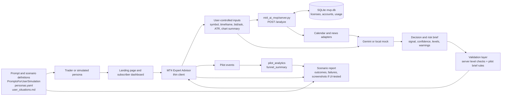

# EUR/JPY brief pilot architecture

This sketch applies the Session 10 harness: a fixed product directive feeds the spec, the
implementation is checked by tests, and synthetic users exercise the workflow without being
treated as evidence from real participants.

## Layers and ownership

| Layer | Current implementation | Responsibility |
|---|---|---|
| Product contract | [product_directive.md](analysis/product_directive.md) | Keeps instrument/time, evidence, uncertainty, invalidation, risk, and non-guarantee rules fixed during an experiment wave. |
| User harness | [personas.yaml](../personas.yaml), [user_situations.md](analysis/user_situations.md), `PromptsForUserSimulation/` | Defines who follows a scenario, what they attempt, and what must be observed. |
| Website and account surface | [server.py](../mt4_ai_mvp/server.py) landing, login, dashboard, simulated checkout, and EA download routes | Lets a user choose a plan, obtain a license key, download the EA, and inspect quota, token estimates, cost, and bound accounts. |
| Client | MT4 thin EA in `mt4_ai_mvp/static/` | Runs inside MetaTrader 4, collects chart/account context, calls `/analyze`, and displays the response; it does not execute trades. The old image/CSV upload prototype is not part of this workflow. |
| Service | [server.py](../mt4_ai_mvp/server.py) | Authenticates a license, binds accounts, fetches calendar/news context, calls Gemini or the local mock, and returns JSON. |
| Persistence | `mt4_ai_mvp/mvp.db` | Stores plans, users, licenses, bound accounts, and usage/quota records. |
| Quality gate | [brief.py](../src/pilot_analytics/brief.py) | Detects missing context, unsupported claims, missing invalidation/risk warnings, and guarantee language. |
| Measurement | [funnel.py](../src/pilot_analytics/funnel.py) | Counts sessions rather than duplicate events and reports activation with visible denominators. |
| Deterministic simulation | [scenarios.py](../src/pilot_analytics/scenarios.py) | Produces repeatable happy-path and failure journeys for tests; it is not participant evidence. |

## Session 10 harness loop

1. Select one persona and one user situation.
2. Visit the landing page and choose a subscription plan.
3. Sign up or log in, then copy the license key from the subscriber dashboard.
4. Download the thin EA and attach it to a MetaTrader 4 chart.
5. Submit the license, account, broker, symbol, timeframe, price, ATR, and chart summary through
   the EA to `/analyze`.
6. Observe the returned brief in MT4 and inspect usage, quota, token estimates, and bound accounts
   in the dashboard.
7. Validate the returned brief against the product directive, record events, and report failures
   separately from synthetic usability observations.
8. For a browser walkthrough, capture screenshots of landing, login, dashboard, download,
   error states, and the MT4 result where the testing environment permits it. The old
   image/CSV upload flow is out of scope.

## Current boundary

The current MVP service covers the subscription/account surface, EA download, license checks,
input submission, brief delivery, and dashboard usage/quota visibility. The server performs
level sanity checks; the Python `validate_brief()` quality gate currently runs in the pilot
analytics/test layer and is not wired into `/analyze`. The service also does not yet expose
source-detail inspection, persistent brief sessions, or follow-up questions. Those are required
to complete the richer pilot situations US-04 and US-05; they should be added as explicit
MT4/server surfaces rather than inferred from the analysis response.
